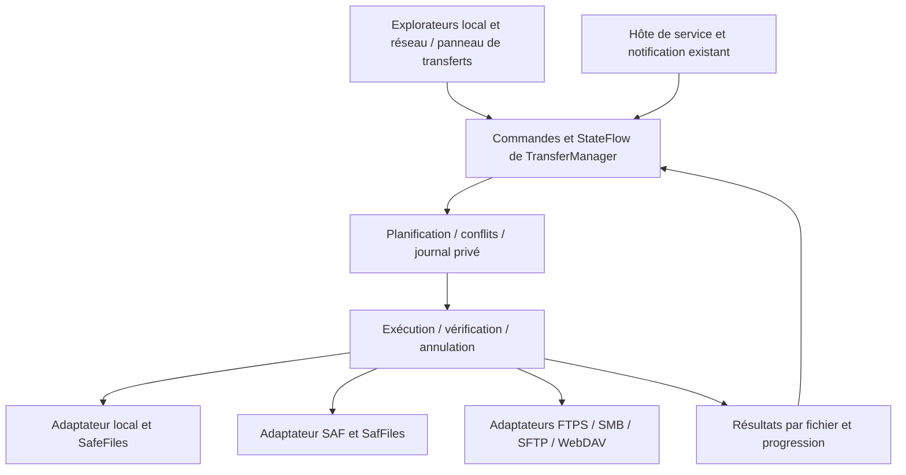

# Proposition technique bêta 18 — gestionnaire commun de transferts

**Document de conception initiale.** La version reste 1.3.0-beta17 / code 27. Les réalisations et limites sont maintenant décrites dans [le lot 1](README-BETA18-LOT1.md) et [le lot 2](README-BETA18-LOT2.md). Les tableaux ci-dessous conservent le contexte de l’audit initial ; ils ne décrivent pas tous l’état actuel. Le lot 2 livre un journal privé de résumé, sans migration Room ni reprise automatique ; l’historique détaillé reste une extension. Lire d’abord [l’audit bêta 17](AUDIT-BETA17.md), notamment les blocages Android et les corrections préalables de corbeille.

## 1. Réutiliser les moteurs, unifier le pilotage

Le gestionnaire doit définir les mêmes règles de sécurité et les mêmes résultats pour les stockages local, USB SAF et réseau. Il ne doit pas remplacer les clients de protocoles, l’authentification ni les protections USB déjà validées.

| Composant existant | Réutilisation prévue | Travail nécessaire avant intégration |
| --- | --- | --- |
| `SafFiles` | Copie local↔SAF, récursion, créations contrôlées, relecture SHA-256, vérification avant suppression | Événements octets/phases, résultats typés, contrôle des alias, invalidation des relations de navigation ; préserver la séquence de validation |
| `SafeFiles` | Validation des noms, `CREATE_NEW`, absence d’écrasement local | Encapsuler la propriété des sorties partielles et la publication sans remplacement |
| `BatchTransfer` | Exécution séquentielle, erreurs par élément, propagation d’annulation | Le remplacer progressivement comme coordinateur par le gestionnaire, sans remplacer le moteur de copie |
| `DownloadStream` | Buffer 256 Kio, compteurs `Long`, annulation et taille attendue | Ajouter le calcul d’empreinte en flux ou un observateur partagé ; distinguer taille inconnue et fichier vide |
| `RemoteFileRepository` | Routage FTPS, SMB, SFTP, WebDAV | Contrat commun de capacités et flux ; pas de nouvelle dépendance issue d’ES Explorer |
| `FtpClientRepository` | Téléchargement FTPS binaire, TLS et contrôle `completePendingCommand` | Taille inconnue typée, annulation pendant une lecture bloquée et fermeture de session ; upload non offert actuellement par ce routage |
| `SmbClientRepository` | Authentification, listage et téléchargement avec `DownloadStream` ; création fichier `FILE_CREATE` dans copie SMB | Ajouter relecture source/destination avant suppression ; boucles annulables ; ne pas exposer `FILE_OVERWRITE_IF` pour une copie sans remplacement |
| `SftpClientRepository` | SSHJ et gestion des connexions existante | Aujourd’hui téléchargement complet sur disque temporaire puis recopie ; `expectedSize` inutilisé, annulation/progression réseau non remontées pendant `sftp.get`. Instrumenter SSHJ ou adopter son flux existant avant d’annoncer une progression réseau exacte |
| `WebDavClientRepository` | OkHttp, flux GET et PUT depuis fichier | Taille/version distante, annulation de l’appel bloqué, création conditionnelle sans remplacement. Le PUT actuel ne suffit pas à garantir l’absence d’écrasement |
| `RemoteDownloadService` | Service, canal, notification, WakeLock, cadence d’affichage et timeout existants | En faire un hôte compatible du coordinateur après validation du cycle de vie ; préserver les contraintes Android de service `dataSync` |
| `RemoteDownloadTarget` | Destinations MediaStore en attente, création exclusive locale, gestion des octrois | Ajouter relecture et preuve de propriété de la destination. Une URI choisie ouverte en `w`, puis supprimée lors d’un échec, ne doit pas être traitée comme une sortie neuve sans preuve |
| `RemoteViewModel.pasteClipboardToLocal` | Commande de transfert et interface | La voie actuelle passe par un fichier temporaire puis `copyTo`, sans relecture avant suppression distante ; rediriger après durcissement |

Les chemins SMB→SMB et réseau→local suppriment actuellement leur source après une copie sans contrôle SHA-256 du contenu à destination. Cela diffère de `SafFiles.move`. La priorité est de rapprocher les garanties, pas d’afficher une barre de progression commune sur des opérations encore différentes.

## 2. Architecture proposée

### Contrats à définir

- `StorageRef` : référence typée `Local`, `SafDocument` ou `Remote(connectionId, protocol, path)`. Pas de conversions génériques URI↔chemin, ni de mots de passe dans le journal.
- `StorageCapabilities` : lecture, création exclusive, écriture, relecture, suppression, listage, identité stable, publication sans remplacement, lecture à partir d’un offset. Les capacités ne sont pas supposées identiques entre fournisseurs ou serveurs.
- `TransferRequest` : liste des racines sélectionnées, copie/déplacement, destination, politique de conflit et préférences de vérification. Capturer la destination avant lancement, indépendamment du panneau actif ensuite.
- `TransferItem` : identifiant, parent logique, source, nom prévu et destination réelle renvoyée par l’adaptateur, taille éventuellement inconnue, état, reçu de vérification et résultat de nettoyage.
- `TransferManager` : ordonnancement, exclusion des opérations sur la même source, `StateFlow`, annulation, résultats et coordination de service. Aucun accès direct au Compose depuis les moteurs.
- `TransferJournal` : entrées et résultats persistants dans le stockage privé. Migration explicite de base, sans migration destructive. Conservation limitée et effacement volontaire de l’historique ; références réseau par identifiant, secrets résolus par les mécanismes existants.
- `TransferVerifier` : contenu, type, structure et présence dans le parent. Réutiliser d’abord la logique de `SafFiles`, puis extraire seulement les primitives nécessaires avec les tests de non-régression.

Les messages affichés peuvent contenir les noms utiles à l’utilisateur. Les logs techniques n’en contiennent jamais ; suivre le schéma de diagnostic de l’audit.

### États et invariants

États par fichier : `QUEUED → PREFLIGHT → COPYING → VERIFYING → VERIFIED → SOURCE_DELETE_PENDING → DONE`. Pour une copie, `VERIFIED → DONE`. États complémentaires : `WAITING_CONFLICT`, `SKIPPED`, `FAILED`, `CANCEL_REQUESTED`, `CANCELLED`, `UNCERTAIN` et `COPIED_SOURCE_DELETE_FAILED`.

**Invariants impératifs :**

1. Aucune suppression source sans reçu de copie/relecture complète confirmé et nouvelle vérification avant la phase destructive.
2. Une fermeture de flux, une taille égale ou une réponse serveur positive isolée ne constituent pas une preuve suffisante de contenu.
3. Une destination existante n’est jamais écrite ou supprimée par une opération qui promet de ne pas remplacer. Vérifier au moment de la création, pas seulement pendant le listage préalable.
4. Nettoyer seulement les objets dont le travail possède une preuve de création ; ne pas supprimer récursivement un dossier susceptible de recevoir des ajouts concurrents.
5. Une permission perdue, une interruption ou un résultat de suppression inconnu reste une erreur/indétermination, pas une réussite ni un motif de suppression supplémentaire.
6. Conserver les protections TLS, certificats et clés existantes. Aucun nouveau protocole non sécurisé introduit.

Au départ, exécuter un seul travail et un seul fichier à la fois. Des canaux `StateFlow` agrègent les mises à jour ; une cadence de 200–300 ms suffit à l’interface. Une concurrence future exige des tests de débit, des quotas et des verrous par stockage avant activation.

## 3. Flux de traitement et mémoire

1. Précontrôle : droits, disponibilité de source et parent, capacités, identité possible, nom, espace lorsque connu et destination hors descendants. Dédupliquer les racines et exclure les descendants déjà couverts par un dossier sélectionné.
2. Découverte progressive de l’arborescence. Compter les **fichiers** séparément des dossiers. Journaliser les éléments progressivement, sans charger une arborescence entière en mémoire. Les répertoires très larges demandent une itération/pagination lorsque le fournisseur le permet ; la limite de `SafFiles.list`, qui construit actuellement une liste, doit être mesurée.
3. Réserver une sortie neuve exclusive ; utiliser une sortie temporaire appartenant au travail si l’adaptateur sait la publier sans remplacement. Ne pas supposer qu’un renommage SAF ou un déplacement « atomique » possède une sémantique universelle de non-remplacement.
4. Copier avec buffers bornés de 64–256 Kio, calculer octets et SHA-256 au fil de l’eau. Réutiliser les flux réseau ; lorsqu’un cache disque reste indispensable à un client, vérifier l’espace et afficher les phases téléchargement/recopie distinctement.
5. Fermer, relire et comparer la sortie, puis confirmer sa présence. Pour un dossier, vérifier chaque enfant et l’arborescence. Pour un déplacement, comparer à nouveau la source actuelle avant toute suppression ; si identité/contenu sont incertains, garder la source.
6. Marquer résultat et reçu. Supprimer chaque source seulement dans la phase autorisée, puis vérifier le résultat de suppression autant que le stockage le permet. Une suppression récursive reste non transactionnelle : rapporter précisément une suppression partielle possible après copie vérifiée.

Ne pas employer `readBytes()` ou un `ByteArrayOutputStream` pour des contenus de fichiers. La mémoire doit dépendre des buffers et des éléments actuellement traités, pas de la taille des fichiers. Compteurs 64 bits, contrôles de débordement et tests au-delà de 4 Gio avec flux synthétiques.

## 4. Progression, conflits, annulation

### Indicateurs

Afficher octets copiés du fichier courant, taille si connue, état « vérification » distinct, fichiers terminés/restants, échecs et ignorés. Le compteur « terminé » d’un déplacement augmente après sa phase finale, pas dès la copie. Pendant la découverte, le nombre total peut rester inconnu : afficher ce fait plutôt qu’un faux pourcentage.

La progression globale utilise les tailles connues seulement après découverte suffisante. Ne pas confondre octets réseau, octets recopiés et octets relus pour vérification ; éviter le double comptage. Afficher la phase et ses compteurs. Le travail n’est pas déclaré terminé à 100 % de copie tant que vérification/suppression restent en cours.

Vitesse : delta d’octets et horloge monotone, moyenne glissante sur quelques secondes, mesures par phase. ETA seulement si octets restants connus et débit stable positif. Suspendre l’estimation lors de conflits, déconnexion ou pause. Une ETA de copie n’est pas une garantie du temps total de relecture/suppression ; afficher « estimation indisponible » quand nécessaire.

### Conflits

Politique par défaut : **refuser et signaler**, avec choix utilisateur ignorer, autre destination ou conserver les deux sous un nouveau nom. Recontrôler le nom renommé à la création pour gérer une collision concurrente. Pas d’écrasement ni de fusion dans la première version du gestionnaire. Une extension de remplacement éventuelle serait une fonctionnalité séparée avec ses propres garanties et confirmation, hors de cette proposition initiale.

### Annulation

Propager `CancellationException` et un token partagé à toutes les boucles. À la demande, arrêter la file et interrompre/fermer les opérations réseau bloquées par les mécanismes de leur client ; un `ensureActive()` entre lectures ne suffit pas si la lecture ne revient pas. Afficher « annulation demandée » jusqu’à confirmation de fin réelle.

Les éléments déjà déplacés restent terminés ; les sources des éléments interrompus/non démarrés restent conservées pendant copie/vérification. Garder la sortie vérifiée si une annulation arrive avant suppression et rapporter « copie conservée, source conservée ». Ne pas promettre un rollback global du lot ni un arrêt atomique d’une suppression récursive déjà commencée.

## 5. Interruption du processus et reprise

Première étape : **pas de reprise automatique par offset**. Au redémarrage, charger le journal et classer les opérations non finales comme interrompues/à vérifier. Ne pas réexécuter une suppression source enregistrée avant crash. Proposer une vérification puis un nouvel essai sur sortie neuve exclusive ; les copies déjà confirmées sont examinées avant de recopier.

Une reprise par offset ne sera activée que pour un couple d’adaptateurs démontrant : identité/version de source fiable et inchangée, propriété de la sortie partielle, accès exact à l’offset, taille/prefixe validés, lecture complète finale et publication sans remplacement. Si une condition manque, recommencer le fichier avec consentement au traitement du partiel.

SAF ne garantit pas ces capacités. Un ETag seul ou une taille/date identique ne prouve pas universellement un contenu inchangé. Même avec une identité distante fiable, la relecture complète finale et la présence dans le parent restent requises. Aucun dispositif ne peut garantir une transaction contre une application concurrente ou une panne physique universelle ; les cas indéterminés doivent conserver les sources.

Le journal assure visibilité et reprise de décision, pas une garantie d’exécution après fermeture. Prévoir le service `dataSync` existant pour les opérations longues, sa notification et ses délais système. Un worker peut ultérieurement analyser les états interrompus ; il ne doit pas relancer silencieusement des déplacements destructifs ni renouveler des autorisations sans intervention.

## 6. Interface et thèmes

Panneau commun de transferts accessible depuis les deux explorateurs, résumé compact d’un travail actif et détail par fichier. Actions identiques : annuler, voir erreurs, traiter conflit, réessayer les seuls éléments concernés. La navigation reste possible ; la destination capturée ne change pas pendant le travail.

Réutiliser Compose Material 3, `MaterialTheme.colorScheme`, typographie et formes existantes. Compatibilité explicite avec LIGHT, DARK, CYANOGEN et SYSTEM/dynamique de `presentation/ui/theme/Theme.kt`. Pas de nouvelles couleurs fixes ni de reproduction de ressources ES Explorer. Ne pas transmettre les noms de fichiers à une notification sur écran verrouillé sans politique de confidentialité adaptée.

## 7. Fichiers à modifier, dans l’ordre

Les chemins ci-dessous sont relatifs à `app/src/main/java/fr/bonobo/filemanager/`, sauf indication. Les nouveaux noms sont des propositions.

| Priorité | Fichiers | Objet et critère de sortie |
| --- | --- | --- |
| P0 préalable | `util/TrashRestorer.kt`, `TrashPaths.kt`, `SafFiles.kt`, `data/repository/FileRepositoryImpl.kt` | Alias de corbeille, portée d’origine, volume absent et mise en corbeille inter-volume ; source préservée sous tous les échecs de copie testés |
| P0 préalable | `presentation/ui/main/MainViewModel.kt`, `MainScreen.kt`, `MainUiState.kt` ; nouveau magasin privé de corbeille | États, prévention des doubles restaurations, exclusion des suppressions concurrentes, nettoyage explicitement confirmé et annulation |
| P0 validation | `app/src/androidTest/.../SafIntegrationTest.kt`, `AdaptiveExplorerTest.kt`, fixtures ; `app/src/test/.../Beta17Test.kt` | Exécuter les 16 existants puis compléter les lacunes de l’audit avant les nouveautés |
| P1 diagnostics | `presentation/components/UsbStoragePicker.kt`, `MainViewModel.kt`, `util/SafFiles.kt` ; nouveaux `StorageAccessStatus.kt`, `StorageDiagnostics.kt` | États indépendants, erreurs typées, sondes bornées et Logcat sans données personnelles |
| P1 socle | Nouveaux `domain/transfer/StorageRef.kt`, `TransferRequest.kt`, `TransferState.kt`, `TransferManager.kt` et contrats d’adaptateurs | Machine d’états et politiques testées avec adaptateurs simulés |
| P1 persistance | Nouveaux `data/local/entity/Transfer*.kt`, `dao/TransferDao.kt` ; `AppDatabase.kt`, `di/DatabaseModule.kt` | Journal privé et migration de schéma explicite, sans perte des favoris/connexions existants ni secrets dans les lignes de travaux |
| P1 moteurs locaux | `util/SafFiles.kt`, `SafeFiles.kt`, `BatchTransfer.kt` et nouveaux adaptateurs local/SAF | Conserver toutes les assertions bêta 16 ; progression/phases et reçus communs |
| P1 réseau | `RemoteFileRepository.kt`, `SmbClientRepository.kt`, `FtpClientRepository.kt`, `SftpClientRepository.kt`, `WebDavClientRepository.kt`, `util/DownloadStream.kt` | Capacité réelle par protocole ; annulation, créations exclusives, vérification avant suppression ; désactiver les déplacements non vérifiables dans le nouveau moteur |
| P2 service | `service/RemoteDownloadService.kt`, `RemoteDownloadTarget.kt` ; manifeste et injection seulement si nécessaire | Cycle de vie, timeout, propriété des partiels, confirmation des sorties et état partagé |
| P2 interface | `presentation/ui/main/{ClipboardState,MainUiState,MainViewModel,MainScreen}.kt`, `presentation/ui/network/{RemoteViewModel,RemoteExplorerScreen}.kt` ; nouveaux composants de progression | Commandes communes, rapport d’erreurs et thèmes ; aucun accès direct aux anciens transferts non sécurisés par la nouvelle interface |
| P3 optionnel | Adaptateurs disposant de capacités de reprise et journal | Reprise par offset uniquement après preuves, sinon maintien du nouvel essai complet |

Aucun changement de numéro de version, de signature ou de bibliothèque n’est nécessaire pour valider cette conception. Les changements de schéma sont futurs, pas appliqués dans cet audit.

## 8. Risques et stratégie de tests

| Risque | Tests et preuve attendue |
| --- | --- |
| Perte de source après fausse réussite | Fournisseur qui perd les écritures, clôture qui échoue, destination illisible, relecture modifiée ; aucune suppression source pendant copie/vérification en échec |
| Doublons de restauration | Deux demandes simultanées, même/différentes destinations, reçu persistant après relance, destination modifiée/disparue ; pas de copie implicite supplémentaire |
| Alias, cycles et noms dangereux | Local↔SAF du même arbre, symlinks/reparse points, racines sélectionnées imbriquées, Unicode, longues origines et noms, doublons d’identifiants ; refus explicite des cas non démontrables |
| Collision concurrente | Destination créée après précontrôle, fournisseur retournant un identifiant existant, conflit de renommage ; contenu préexistant intact |
| Annulation incomplète | Avant création, pendant lecture lente, fermeture, relecture, entre éléments et avant suppression ; lectures réseau bloquées, fermeture effective et statut précis |
| Panne après vérification | Crash aux transitions du journal, suppression source échouée/partielle, fermeture du processus ; aucune suppression automatiquement rejouée au redémarrage |
| Progression trompeuse | Fichier vide, taille inconnue, arborescence découverte en cours, compteur >4 Gio, débit nul et changement d’horloge murale ; tests avec horloge monotone simulée |
| Mémoire/disque | Gros flux générés sans fichier complet en mémoire, très gros dossier, manque d’espace du cache SFTP ; buffers bornés et erreur conservant la source |
| Permissions et USB | Octroi temporaire valide sans persistant, révocation réelle, lecture seule, volume absent/non monté, URI supprimée mais racine valide, erreur fournisseur et retour d’une activité tierce synthétique |
| Réseau | Fixtures FTPS/HTTP/WebDAV locales et adaptateurs simulés SMB/SFTP, puis serveurs de recette isolés ; aucun NAS réel. Ne pas prétendre valider un protocole avec un simple mock |
| Persistance et thèmes | Migration de la base existante sans effacement, relance sans secrets dans le journal, rotation/deux panneaux, LIGHT/DARK/CYANOGEN/SYSTEM, accessibilité et logs contrôlés |

Démarche : exécuter d’abord le corpus actuel, introduire les contrats avec simulations JVM déterministes, raccorder local/SAF, puis chaque protocole séparément. Pour chaque étape, ajouter les tests de propriétés de sécurité et les fixtures d’erreurs, exécuter JVM Debug/Release, Android sur émulateur dédié, compilations et Lint sans masquage. Une phase suivante ne doit pas se fonder sur un succès Android simplement compilé.

Les essais sur clé physique et ES Explorer resteront une recette manuelle sur données synthétiques, effectuée ultérieurement par le testeur. Ils ne pourront pas être remplacés par un fournisseur simulé, ni garantir la résolution d’un verrou exclusif d’une autre application.
